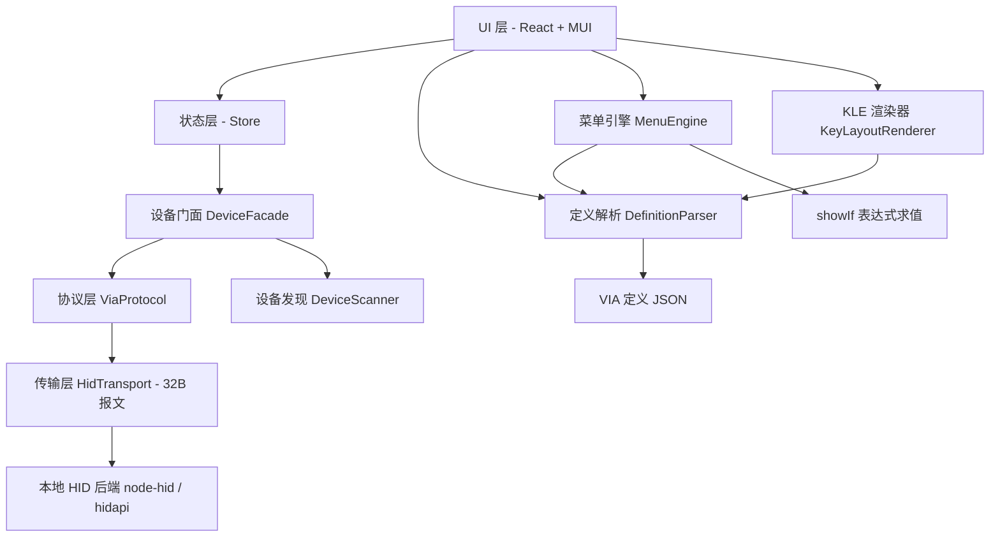

# 本地键盘驱动程序 PRD（VIA 兼容 · 桌面 GUI）

> 文档版本：**v1.5**（定稿）
> **数字来源约定**：本文件所有关于定义文件的统计数字，一律以
> `scripts/verify-definition-stats.mjs`（架构师交付，Node 原生零依赖）的**程序化输出为准**，
> 不做人工归并或推断。更换定义文件时，应**以脚本输出更新本文档**，禁止反过来改断言去迁就文档。
>
> **数字分三类，处理方式不同**：
>
> | 类别 | 例子 | 处理 |
> | --- | --- | --- |
> | **① 基线事实**（描述定义文件） | 8 菜单 / 67 分组 / 349 控件 / 98 KLE 条目 | **以脚本输出为准**，人工不得改写；§4.6 的 A1–A16 即此类 |
> | **② 工具自身属性**（描述脚本/文档自己） | 脚本断言条数、文档行数 | **不锁定具体数值**。验收只要求「全部断言通过 + 退出码 0」。此类数字必然随工具演进而过期，写死即产生漂移 |
> | **③ 估算值**（用于排期，非事实） | 模块预估代码行数、工期 | **必须显式标注"预估"**，且**不得给出虚假精度**（写"约 800 行"，不写"817 行"） |
>
> ⚠️ 上述约定同样适用于**聊天消息中的数字**——口头/消息中的数字不具权威性，任何人可随时跑脚本证伪。
> 撰写：许清楚（产品经理）
> 项目根目录：`/Users/baoru/Downloads/AI/keydriver`
> 目标定义文件：`/Users/baoru/Downloads/7-19-Em60_cn.json`

### 版本记录

| 版本 | 变更 |
| --- | --- |
| v1.0 | 初版：调研 + 需求分析 + 协议要点 + 需求池 + UI 稿 |
| **v1.1** | 依据软件架构师的程序化逐字段实测结果修正 3 处描述错误，并补充可当验收断言的精确数据。详见 §4.3、§4.4、§6.1 R-P0-10/R-P0-12、§8、§9 Q3。修正点：<br>① `content[0]` **不是唯一标识**（存在 2 处重复）→ 控件 ID 改为「菜单路径 + 序号」；<br>② `showIf` **不只作用于叶子控件**（60 条中 2 条在分组节点上，且分组可无 `label`）；<br>③ 菜单树用 `content` 承载子节点（无 `children` 字段），需靠「有无 `type`」判别语义 |
| **v1.2** | 与架构师二轮交叉复核后补充 `range` / `button` 的**精确计数**，新增断言 A13–A14，Q3 完全收敛：<br>① `range` 5 种组合各自条数（21/22/22/10/3=78）；<br>② **字节宽度拆分 43(1字节) / 35(2字节)**；<br>③ **min 拆分 43(min=0) / 35(min=1)**，滑块下限禁止写死 0；<br>④ 标注「min=1 的 35」与「2 字节的 35」为**数值巧合、语义无关**；<br>⑤ `button` 的 `[1]` 确认为**真参数**，须原样透传 |
| **v1.5（定稿）** | 依主理人裁决，按「协议层 + 模块划分交叉复核」的 13 条差异更新，共 8 处：<br>① **§5.2**：v3 要求 **≥ 11**（11 是阈值下界非期望值），**QMK 当前为 13**；<br>② **§5.3**：补 `0x06 keycodes_version`（4 字节大端 BCD，合法范围 0x00000008–0x00000009）；<br>③ **§5.3**：`0x03 switch_matrix_state` 标注**默认返回全 0**；<br>④ **§5.6**：握手新增第 3 步「protocol ≥ 13 必读 keycodes version」，并注明 via-app 语义是**抛错**非静默降级；<br>⑤ **§5.6**：补 buffer offset 公式 + 「28 字节 = 14 个 keycode」；<br>⑥ **§1**：应用形态改为「Web SPA + `--app` 窗口，M4+ 可选 Electron」，去掉隐含原生 HID 的表述；<br>⑦ **§8**：`NodeHidBackend.ts` → `WebHidTransport.ts`，并加醒目说明「**以 ARCHITECTURE.md §3 为准**」+ 差异对照表；<br>⑧ **R-P1-03 → 降级为 R-P2-07**（默认固件下验收无法达成）；<br>另：§5.1 补「响应有效性判据」（参数回声一致性，坑点 1 的正面防御） |
| **v1.4** | 顶部「数字来源约定」升级为**数字三类分治规则**：① 基线事实（以脚本为准，人工不得改写）② 工具自身属性（不锁数值，只约束结果）③ 估算值（必须标注"预估"且不得给虚假精度）。并明确：**该约定同样适用于聊天消息中的数字**，口头数字不具权威性 |
| **v1.3** | 与架构师三轮交叉复核，新增 A15–A16，并把巧合警告**升级为可证伪的量化结论**：<br>① 新增 `content` 长度 × 控件类型分布（A15），发现 **`keycode` 最短为 4**（从不为 3）；<br>② 巧合结论量化：**两维度集合交集仅 13**（A16），若误当同一批会导致 **44 个 range 判错**（两个方向各 22，误判面 44/78 过半）；<br>③ 顶部加入「数字来源约定」，锁定 `scripts/verify-definition-stats.mjs` 为唯一数字出处<br>④ **v1.3.1**：脚本升级至 23 条断言（新增误判面 44 等 4 条），已复验全绿；PRD 中"19 条"同步修正，且改为**不锁定条数**只要求"全绿 + 退出码 0"，避免脚本演进后 PRD 再次过期 |

---

## 1. 项目信息

| 项 | 值 |
| --- | --- |
| Language | 简体中文 |
| Project Name | `keydriver`（建议仓库/目录名） |
| 应用形态 | **本期：Web SPA（Chrome / Edge 打开 localhost）+ `chrome --app=` 独立窗口形态**（无地址栏、无标签页、独立 Dock 图标，体验等同桌面应用）；**M4+ 可选：Electron 零改造接入，本期不验收**。详见架构文档 §1.1 / §1.2 |
| 默认技术栈建议 | ~~Vite + React + TypeScript + MUI + Tailwind CSS~~ → **以架构文档 §1.1 为准**（架构已裁决为 Vite + React 19 + TS 5.9 + **Tailwind CSS 4.3 + Radix UI**；MUI 已被否决） |
| 核心协议 | VIA Protocol v11（V3 定义格式）+ QMK Raw HID。**注：v11 为阈值下界，QMK 当前协议版本为 13**，详见 §5.2 |
| 关键依赖能力 | **WebHID（`navigator.hid`）** 为主；`HidTransport` 接口 + `DummyTransport` 为风险对冲；node-hid 降为 P2 预留接口（架构文档 §1.1 已裁决） |

### 1.1 原始需求复述

用户（开发者）要求：参考 `usevia.app`（VIA 官方开源网页驱动）的实现，结合其提供的一份 VIA 键盘定义配置文件，开发一个**可在本地运行**的键盘驱动程序。要求：

1. 分析 `usevia.app` 源码与配置文件的**结构、配置格式与核心功能**；
2. 实现网页版驱动的**核心功能**（改键 / 灯效 / 各类高级设置）；
3. GUI 设计**现代化、简洁美观**，可读性与易用性强；
4. 代码结构**清晰**，具备**跨平台运行**的基础；
5. 能**读取并解析**用户提供的配置文件；
6. 说明**主要模块划分与实现思路**；
7. 明确允许参考 / 复用开源实现（"先搜集资料看别人的成品，可以抄袭"）。

---

## 2. 产品定义

### 2.1 一句话定位

**一个跨平台、可离线运行的桌面版 VIA 键盘配置器——用本地 HID 通道直连键盘，加载用户自己的 VIA 定义文件，实时可视化改键与调节全部自定义功能。**

### 2.2 产品目标（Product Goals）

| # | 目标 | 可度量标准 |
| --- | --- | --- |
| G1 | **零编译改键**：像 usevia.app 一样，改键与参数调整即时写入键盘 EEPROM，拔插后保持 | 点击键位 → 选键码 → 200ms 内键盘生效；断电重启后配置仍保留 |
| G2 | **定义文件驱动 UI**：应用本身不硬编码任何键盘型号，UI 完全由 VIA 定义文件（含 `menus`）动态生成 | 仅靠替换一份 JSON，即可支持另一把键盘的全部功能面板 |
| G3 | **完整承载目标配置文件的 349 个控件**：6 类控件 + `showIf` 条件渲染 + 多维索引参数全部可用不降级 | `7-19-Em60_cn.json` 中 8 大菜单、349 个控件 100% 可渲染、可读写 |
| G4 | **真本地、真跨平台**：无需浏览器 WebHID 授权、无需联网、无 Chromium 依赖 | Windows 10/11、macOS 12+、Ubuntu 22.04+ 均可启动并连接设备 |
| G5 | **配置可备份可迁移**：支持把当前键盘的全部状态导出为文件并还原 | 导出 → 重置键盘 → 导入 → 状态逐项一致 |

### 2.3 用户故事（User Stories）

| # | 用户故事 |
| --- | --- |
| US1 | 作为**键盘用户**，我希望插上键盘后应用能自动识别并列出设备，以便一键连接、无需在浏览器里反复授权。 |
| US2 | 作为**键盘用户**，我希望在可视化键位图上点击某个键并从键码库中选择新功能，以便立刻完成改键，不用编译固件。 |
| US3 | 作为**键盘用户**，我希望在多个层（Layer 0~N）之间切换编辑，以便为 Fn 层、游戏层分别配置键位。 |
| US4 | 作为**灯效爱好者**，我希望用下拉框 / 滑块 / 取色器调节亮度、灯效、速度、颜色，以便实时预览灯效；且当灯效为"All Off"时自动隐藏速度与颜色控件，避免误操作。 |
| US5 | 作为**游戏玩家**，我希望配置 RT（快速触发）、SOCD（同时反向按键清理）、按键连发的全局开关与分层开关及各自参数，以便针对不同游戏切换手感。 |
| US6 | 作为**进阶用户**，我希望配置 Tap Dance（单击/长按/双击/双击长按）、Combos（4 输入键 + 1 输出键 + 判定时间），以便把复杂操作压到单个键上。 |
| US7 | 作为**静电容键盘用户**，我希望执行触底校准、底噪校准、查看/清除校准数据、切换触发模式并保存阈值，以便让键盘适配我的按压力度。 |
| US8 | 作为**担心配置丢失的用户**，我希望把当前全部配置导出成 JSON 备份到磁盘，并在需要时一键还原，以便放心尝试各种改法。 |

---

## 3. 调研结论

> **调研说明（诚实声明）**：
> - `github.com/the-via/app` 与 `caniusevia.com/docs/custom_ui` 的**直连抓取返回空内容**（GitHub 页面为 JS 渲染），故改以 **DeepWiki 结构化镜像**（对同一仓库源码的解析）与 **caniusevia 官方文档的搜索摘要**作为依据，并交叉比对了 `qmk_firmware/quantum/via.h` 源码片段。
> - `vial-kb/vial-gui` 仓库页面**抓取成功**，DeepWiki 解析成功。
> - 下文所有"文件路径"均来自上述真实来源；标注「推测」的部分为我的推断，未经源码逐行验证。

### 3.1 `the-via/app`（usevia.app 源码）

| 维度 | 内容 |
| --- | --- |
| 技术栈 | React + TypeScript + Redux Toolkit（`@reduxjs/toolkit`）+ Three.js（3D 键盘）+ Vite 构建；路由用 `wouter` |
| 设备通信 | 浏览器 **WebHID API**；核心封装 `src/utils/keyboard-api.ts`（`KeyboardAPI` 类），底层 `src/utils/usb-hid.ts` |
| 目录划分 | `src/components/panes/`（configure / test / design / settings / debug / errors 五大面板）<br>`src/components/panes/configure-panes/`（keymap、macros、lighting、save-load、custom…）<br>`src/store/`（`definitionsSlice`、`keymapSlice`、`macrosSlice`、`menusSlice`、`devicesThunks`）<br>`src/utils/`（`keyboard-api.ts`、`usb-hid.ts`、`pane-config.ts`、`keycode-render`、`use-keycode-recorder`）<br>可复用 npm 包：`@the-via/reader`（定义解析）、`@the-via/pelpi`（`showIf` 表达式求值） |
| 定义管理 | 基础定义（内置）+ 自定义定义（**IndexedDB** 持久化）+ Redux 运行时状态三层；通过 Design 面板拖拽导入 JSON，按 V2/V3 schema 校验 |
| 定义版本 | **V2**（协议 ≤ 10）与 **V3**（协议 ≥ 11）。V3 新增 `menus`、`customFeatures`、`firmwareVersion`，并废弃 `lighting` 字段 |
| 菜单引擎 | `src/components/panes/configure-panes/custom/menu-generator.tsx` 递归解析 `menus`，生成 React 组件；`custom-control.tsx` 按 `type` 分发到具体控件；`src/store/menusSlice.ts` 维护菜单值状态 |
| `showIf` | 由 `@the-via/pelpi` 的 `evalExpr` 求值。语法：`{valueKey}` 变量引用 + `==`、`!=`、`>`、`>=`、`<`、`<=` + `&&`、`||` + `+ - * /` 算术。求值结果为假时组件被过滤掉 |
| 控件体系 | `AccentButton` / `AccentSlider` / `AccentRange` / `AccentSelect` / `AccentColor` 等统一风格基础控件；键码选择器为独立面板 |
| 键位渲染 | 2D（`CanvasRouter2D`）与 3D（`CanvasRouter3D`）双渲染器；KLE JSON → 键位坐标（`src/utils/keyboard-rendering.ts`） |
| **可借鉴点** | ① 定义文件 → UI 的**完全数据驱动**架构（新增键盘零改码）；② `menus` 递归菜单生成器 + 控件工厂；③ `showIf` 表达式引擎（可直接移植思路或复用 `pelpi` 的思路自研）；④ 键码分组体系（Basic / Media / Macro / Layers / Special / QMK Lighting / Custom） |
| **坑点** | ① 强依赖浏览器 WebHID，**本地桌面化必须替换这一层**（这是本项目最大的移植工作量）；② Redux + Three.js 对本地小工具属于过度设计，可砍掉 3D；③ 定义文件依赖远程仓库下载，本地化需改为本地文件管理 |

### 3.2 `vial-kb/vial-gui`（**最接近本项目目标的成品**）

| 维度 | 内容 |
| --- | --- |
| 技术栈 | **Python 3.6 + PyQt5 + fbs（打包） + hidapi（经 `hidproxy.py` 代理 `cython-hidapi` / `hid`）** |
| 入口 | `src/main/python/main.py`（`VialApplicationContext`）→ `main_window.py`（`MainWindow`） |
| 目录划分 | `src/main/python/`<br>　├ `main.py` / `main_window.py`（主窗口、菜单栏、Tab 容器、设备下拉框）<br>　├ `util.py`（`hid_send()`、`MSG_LEN=32`、`find_vial_devices()`、`Keycode`/`KeycodeDisplay`）<br>　├ `vial_device.py`（`VialDevice` → `VialKeyboard` / `VialBootloader` / `VialDummyKeyboard`）<br>　├ `protocol/`（`keyboard_comm.py` 主协议类 `Keyboard`；`base_protocol.py` 动态条目基类；`constants.py` 命令常量；`dynamic.py` 动态特性探测；`macro.py` / `tap_dance.py` / `combo.py` / `key_override.py` / `alt_repeat_key.py`）<br>　├ `editor/`（`keymap_editor.py`、`macro_recorder.py`、`rgb_configurator.py`、`tap_dance.py`、`combos.py`、`key_override.py`、`qmk_settings.py`、`matrix_test.py`、`firmware_flasher.py`、`alt_repeat_key.py`）<br>　├ `widgets/`（`display_keyboard.py`、`tabbed_keycodes.py`、`key_widget.py`）<br>　└ `autorefresh/`（`autorefresh.py`、`autorefresh_thread.py`（1s 轮询）、`autorefresh_thread_win.py`（WM_DEVICECHANGE 事件）、`autorefresh_thread_web.py`） |
| 设备发现 | `find_vial_devices()` 遍历 `hid.enumerate()`，按 4 种启发式识别：<br>① 序列号含 `vial:f64c2b3c` → `VialKeyboard`<br>② 序列号含 `vibl:d4f8159c` → `VialBootloader`<br>③ VID/PID 命中 `via_stack_json` → `VialKeyboard(via_stack=True)`<br>④ 用户侧载 VID/PID → `VialKeyboard(sideload=True)`；全 0 → `VialDummyKeyboard`（无硬件也能开发） |
| Raw HID 校验 | `is_rawhid()`：Usage Page = **0xFF60**、Usage = **0x61**；Linux 下额外 `open_path` 试探以检测 udev 权限 |
| 协议栈 | `Keyboard` 类（mixin 组合）：`ProtocolMacro` / `ProtocolTapDance` / `ProtocolCombo` / `ProtocolKeyOverride` / `ProtocolDynamic`。支持 **VIA 协议 v9**、**Vial 协议 v0–v6**；按版本开关特性（v2 高级宏、v4 动态条目 + QMK Settings、v5 双字节宏 + Key Override） |
| 数据同步 | 键位按 `BUFFER_FETCH_CHUNK = 28` 字节分块用 `CMD_VIA_KEYMAP_GET_BUFFER` 拉取后重组；`_retrieve_dynamic_entries` 按索引遍历拉取动态条目 |
| **可借鉴点** | ① **分层协议栈**（传输层 / 命令层 / 特性协议 mixin）— 本项目最该抄的结构；② **设备自动发现 + 热插拔轮询 + 平台差异化事件**；③ **Dummy 设备**机制，让无硬件也能开发与自测（强烈建议本项目也做）；④ **协议版本握手 + 按版本开关特性**；⑤ 各功能一个 editor 模块、一个 protocol 模块的 1:1 对称划分 |
| **坑点** | ① Python 3.6 + fbs 打包链路老旧，GUI 观感偏传统 Qt，不满足"现代化美观"要求；② 其定义是编译进固件的 `.vil`，与本项目"加载外部 JSON"路径不同；③ Qt 主题定制成本高 |

### 3.3 两者对比与本项目取舍

| 对比项 | the-via/app | vial-gui | **本项目取舍** |
| --- | --- | --- | --- |
| 形态 | Web（WebHID） | 桌面（PyQt5 + hidapi） | **桌面**（Vial 路线） |
| UI 技术 | React + TS | PyQt5 | **React + TS + MUI/Tailwind**（VIA 的现代观感 + Vial 的桌面形态） |
| 定义来源 | 远程仓库 + IndexedDB | 固件内 `.vil` | **本地 JSON 文件加载**（本项目特有） |
| 菜单引擎 | 有（`menu-generator` + `showIf`） | 无（各功能硬编码 editor） | **抄 VIA 的菜单引擎**（目标文件重度依赖 `menus`） |
| 协议分层 | `keyboard-api.ts` 单类 | `protocol/` 多模块 mixin | **抄 Vial 的分层**，但只实现 VIA v11 子集 |
| 设备发现 | WebHID 授权弹窗 | `find_vial_devices()` 轮询 | **抄 Vial 的启发式 + 增加 VID/PID 侧载**（目标文件给了 VID/PID） |
| 渲染 | 2D + 3D | 2D | **只做 2D**（KLE → Canvas/DOM） |
| 值语义 | 键码 + 自定义值（channel/value_id） | 键码 + 各特性结构化数据 | **以自定义值（channel/value_id）为主**（目标文件 6/8 菜单走这条） |

### 3.4 通用坑点清单（写给架构师）

1. **协议版本方言陷阱**：VIA v2（协议 ≤10）与 v3（协议 ≥11）的 `0x07/0x08/0x09` 命令**命令码相同但帧格式不同**——v3 多一个 `channel_id` 字节。固件会**原样回显**无法识别的包，因此"发错方言"表现为"看起来成功但读回全是 0"，**没有任何错误可捕获**。→ 必须先做 `0x01 GetProtocolVersion` 握手，再决定帧格式。
2. **Windows hidapi 需要前置 report ID 字节**：写入缓冲区要在 32 字节负载前补一个 `0x00`（共 33 字节给 `write()`），读取时按 32 字节收。
3. **单包有效负载只有 28 字节**：32 字节减去命令头，键位/宏缓冲区必须分块（chunk = 28）。
4. **权限问题**：Linux 需 udev 规则（否则 `open_path` 失败）；macOS 需输入监控/辅助功能权限侧写（视实现而定）。
5. **RAW HID 接口判别**：必须用 Usage Page `0xFF60` / Usage `0x61` 过滤，否则会把系统键盘/鼠标接口也当成设备。
6. **EEPROM 写入有寿命**：`range` 滑块拖动会高频触发写命令 → 必须**防抖 + 显式保存**（QMK 侧有 `VIA_EEPROM_SAVE_INTERVAL` 节流机制）。
7. **`button` 类型语义特殊**：它不是"设置值"而是"触发动作"（如 Jump to bootloader、Reset、校准），`options` 是动作参数；点完可能**导致设备断开**，UI 必须有二次确认与断连处理。

---

## 4. 目标配置文件分析（EC_BM60）

### 4.1 文件整体结构（已实测解析）

```
7-19-Em60_cn.json
├── name            : "EC_BM60"
├── vendorId        : "0x5594"
├── productId       : "0x0005"
├── matrix          : { rows: 5, cols: 15 }        // 最大 75 个矩阵位
├── customKeycodes  : 2 个（键盘锁 / WIN锁）      // name / title / shortName
├── menus           : 8 个顶层菜单，共 349 个控件
└── layouts
    ├── labels      : 5 个布局选项组
    └── keymap      : 9 行 KLE 数据，98 个键位条目，去重后 66 个矩阵位置
```

### 4.2 重要结论：这是 **V3 定义文件，不是 V2**

文件**含有 `menus` 字段**——而 `menus` 是 VIA **V3**（协议 ≥ 11）才引入的字段（V2 用 `lighting`）。因此：

- 应用必须按 **VIA 协议 v11（V3）帧格式**通信：`0x07/0x08/0x09` 命令 = `[cmd, channel_id, value_id, ...data]`；
- 无需兼容 V2 的 `lighting` 字段；
- 建议仍做版本握手（读 `0x01`）并做一次 `id_firmware_version`（`0x02` + `0x04`）比对，用于校验定义文件与固件是否匹配。

### 4.3 菜单与控件规模（实测）

| 顶层菜单 | 子分组数 | 说明 |
| --- | --- | --- |
| 静电容工具 | 3 | 触发 / 校准 / 其他（含 bootloader、Reset、键盘锁） |
| 灯光 | 3 | 灯光开关 / Backlight / 指示灯（Caps·Num·Scroll + Layer0-4） |
| Magic设置 | 8 | NKRO、锁Gui、各种交换键、Grave Esc、单击长按、OneShot、自动Shift、组合键、鼠标键 |
| 按键复用 | 16 | Tap Dance 0-14 + 重置 |
| 组合键 | 11 | Combos 0-9 + 全局开关 |
| SOCD | 5 | 全局 + 6 层开关 + SOCD(0)-(3) |
| RT | 5 | 全局 + 6 层开关 + RT(0)-(3) |
| 按键连发 | 6 | 全局 + 6 层开关 + 连发(0)-(4) |

**菜单树结构（v1.1 实测补充）**

| 结构指标 | 实测值 |
| --- | --- |
| 顶层菜单 | 8 |
| **分组节点总数（含 8 个顶层）** | **67** |
| 叶子控件总数 | 349 |
| **菜单最大嵌套深度** | **4 层**（菜单 → 分组 → 条件分组 → 控件） |

**控件类型统计（共 349 个）**

| type | 数量 |
| --- | --- |
| `keycode` | 131 |
| `toggle` | 90 |
| `range` | 78 |
| `dropdown` | 33 |
| `button` | 9 |
| `color` | 8 |

> 设计启示：**`keycode` 选择器（131 个）是第一大控件**，必须做成体验良好的独立面板/弹窗，而不是每处重复实现一个下拉框。

### 4.4 节点结构与 `content` 数组语义（关键）

#### 4.4.1 `content` 有两种含义，靠「有无 `type` 字段」判别（v1.1 修正）

同一个 `content` 键在两类节点上语义完全不同：

| 节点类型 | 判别方式 | `content` 含义 |
| --- | --- | --- |
| **分组节点** | **无 `type` 字段**，有 `label`（可缺省） | 子节点数组：`{label, content: [...]}`，可嵌套至 4 层 |
| **控件（叶子）节点** | **有 `type` 字段**（dropdown/range/toggle/button/color/keycode） | 地址元组：`[valueKey, channel, valueId, index?, index2?]` |

⚠️ 菜单树中**不存在 `children` 字段**，子节点一律挂在 `content` 下。解析器必须先判 `type` 再决定如何解释 `content`。

#### 4.4.2 控件节点的 `content` 元组

`content: [valueKey, channel, value_id, index?, index2?]`

- `content[0]` = **valueKey**（字符串，**仅作为 `showIf` 求值上下文的变量名**，不下发给固件）
- `content[1]` = **channel_id**（下发给固件）
- `content[2]` = **value_id**（下发给固件）
- `content[3]` / `content[4]` = **索引下标**（下发给固件，用于数组型参数，如 Tap Dance[0]、Combos[9][3]）
- 数组长度在本文件中出现 **3 / 4 / 5** 三种

#### 4.4.3 ⚠️ `content[0]` **不是唯一标识**（v1.1 修正）

实测存在 **2 处 valueKey 重复**，因此**禁止**用 `content[0]` 作为控件唯一 ID：

| 重复 valueKey | 出现次数 | 形态 | 说明 |
| --- | --- | --- | --- |
| `id_save_threshold_data` | 2 | `button`，options 分别 `[0]` / `[1]` | 两个 button 分属**互斥的两个 showIf 分支**（触发模式 0 与模式 1），任一时刻只有一个可见 |
| `id_magic_oneshot_enable` | 2 | `toggle`，指向**同一地址** `channel 7 / valueId 12` | 分别位于「Magic设置」与「OneShot设置」两个分组下，**是同一份数据的两个入口** |

**处理约定（架构师已采纳）**：
- 控件唯一 ID = **菜单路径 + 序号**（如 `静电容工具/触发/0`），不用 valueKey；
- `valueKey` 只作为 `showIf` 表达式的**变量名**参与求值（因此重名在同一求值上下文内是合法的）；
- 第二例（同地址多入口）意味着**一处修改必须同步刷新另一处 UI**，属于数据绑定而非控件独立状态 —— UI 层须按「地址」而非「控件 ID」做值订阅。

#### 4.4.4 ⚠️ `showIf` 不只作用于叶子控件（v1.1 修正）

实测 **60 条 `showIf`** 分布：

| 挂载位置 | 数量 | 是否带 `label` |
| --- | --- | --- |
| 叶子控件 | **58** | — |
| **分组节点** | **2** | **均无 `label`**（0 个带 label） |
| 合计 | 60 | |

那 2 个无 label 的条件分组形如：

```json
{ "showIf": "{id_actuation_mode} == 0",
  "content": [ { "label":"触发电平 (0% | 100%)", "type":"range", ... }, ... ] }
```

即「静电容工具 → 触发」下按触发模式切换的**一整组控件**。

**处理约定**：
- 菜单引擎必须在**分组层与叶子层都求值** `showIf`，不能只在叶子层判；
- 分组的 `label` **可以缺省**；缺省时不渲染子标题，把子节点**内联展开**到父级分组中。

**本文件 channel 分布实测**

| channel | 控件数 | value_id 范围 | content 长度 | 推测语义（按 QMK 官方 channel 定义 + 命名推断） |
| --- | --- | --- | --- | --- |
| 0 | 16 | 1–33 | 3 | `id_custom_channel` — 静电容工具（EC） |
| 3 | 4 | 1–4 | 3 | `id_qmk_rgb_matrix_channel` — RGB Matrix（亮度/灯效/速度/颜色） |
| 5 | 1 | 1 | 4 | `id_qmk_led_matrix_channel` — LED Matrix 总开关 |
| 6 | 32 | 1–5 | 3/4 | 键盘级自定义 — RGB 指示灯（亮度/灯效/灯珠/颜色） |
| 7 | 14 | 1–13 | 3 | 键盘级自定义 — Magic 开关（NKRO、锁Gui、交换键…） |
| 8 | 40 | 0–33 | 3/4 | 键盘级自定义 — Advanced Magic（Grave Esc、Tap-Hold、OneShot、Auto Shift、Combo、鼠标键） |
| 9 | 106 | 0–7 | 3/4 | 键盘级自定义 — **Tap Dance（按键复用）** |
| 10 | 61 | 0–3 | 3/4/**5** | 键盘级自定义 — **Combos（组合键）**，含二维索引 `[n][k]` |
| 12 | 19 | 1–6 | 3/4 | 键盘级自定义 — **SOCD** |
| 13 | 19 | 1–6 | 3/4 | 键盘级自定义 — **RT（按键切换/快速触发）** |
| 14 | 37 | 1–9 | 3/4 | 键盘级自定义 — **按键连发（Auto Repeat）** |

> 注：channel 11 未出现。channel ≥ 6 均为**厂商自定义通道**，语义由命名推断，**以实机验证为准**。

### 4.5 `layouts` 与布局选项

- `labels` 共 5 组：`退格键`（3 选）、`分裂左shift`（开关）、`大回车`（开关）、`右shift`（3 选）、`配列选择`（5 选：True hhkb / WK / WKL / HHKB / 7U WK）
- `keymap` **9 行**：第 0–3 行为主键盘区（16+15+14+16=61 个条目），第 4–8 行为**底行（row 4）的 5 种配列变体**（8+8+7+7+7=37 个条目）
- 键名格式：`"row,col"` 或 `"row,col\n\n\n<group>,<option>"`（KLE 右下角图例表示"布局选项组 X 选 Y 时生效"）
- 键属性对象支持：`x`、`y`、`w`、`h`、`w2`、`h2`、`x2`、`y2`、`c`（颜色）、`d`（禁用）
- **渲染规则**：读取键盘的 `layout_options`（32 位 bitfield，经 `0x02`/`0x03` + value_id `0x02` 读写），据此决定每个 group 选中的 option，再筛选出当前生效的键位集合

### 4.6 精确数据清单（v1.1 新增 · 可直接作为验收断言）

以下均为程序化逐字段解析的实测值，建议直接写进单元测试 / 冒烟用例：

| # | 断言项 | 实测值 |
| --- | --- | --- |
| A1 | 顶层菜单数 | 8 |
| A2 | 分组节点总数（含顶层） | 67 |
| A3 | 叶子控件总数 | 349 |
| A4 | 菜单最大嵌套深度 | 4（菜单 → 分组 → 条件分组 → 控件） |
| A5 | 控件类型分布 | keycode 131 / toggle 90 / range 78 / dropdown 33 / button 9 / color 8 |
| A6 | `showIf` 总数 | 60（叶子 58 + 分组 2，分组均无 `label`） |
| A7 | `content[0]` 重复项 | 2 处：`id_save_threshold_data`、`id_magic_oneshot_enable` |
| A8 | `range` 的 `options` 组合**及各自条数** | 共 78 个，5 种：`[0,255]` × **21**、`[1,255]` × **22**、`[0,1000]` × **22**、`[1,1000]` × **10**、`[1,1023]` × **3**<br>→ max 仅取 **255 / 1000 / 1023** 三档 |
| A9 | `button` 的 `options` | `[0]` × **7**、`[1]` × **1**、**`null` × 1**（共 9） |
| A10 | `dropdown` 的 `options` 形态 | `string[]`（值为索引）2 个；`[label, value][]` 31 个 |
| A11 | `content` 元组长度 | 3 / 4 / 5 三种 |
| A12 | `keymap` | 9 行，98 条目，去重后 66 个矩阵位置 |
| A13 | `range` 的 **min 拆分** | min=0 → 43 个；min=**1** → **35** 个 |
| A14 | `range` 的 **字节宽度拆分** | max=255 → **43 个走 1 字节**；max>255 → **35 个走 2 字节**（其中 max=1000 共 32 个、max=1023 共 3 个） |
| A15 | **`content` 长度 × 控件类型**分布（合计 349） | `dropdown`：3→3 个、4→30 个<br>`range`：3→26 个、4→52 个<br>`toggle`：3→22 个、4→68 个<br>`button`：3→9 个（**仅长度 3**）<br>`color`：3→1 个、4→7 个<br>`keycode`：4→91 个、5→40 个（**最短为 4，从不为 3**） |
| A16 | ⚠️ **两维度集合交集** | min=1 集合（35）∩ 2 字节集合（35）= **仅 13 个** |

> **A9 说明**：`button` 的 `options` 存在 **`null`** 写法，解析器必须容忍 `options` 缺失/为 null，不能假设它一定是数组；且 **`[1]` 的存在证明该字段是真参数而非常量**，必须**原样透传**，禁止图省事写死 `args: [0]`。
>
> **A8 / A13 / A14 说明（见 §9 Q3）**：
> - 「max > 255 → 2 字节」的推断规则在本文件上**无歧义**；
> - ⚠️ **min 也可能是 1**（共 35 个），滑块下限必须取 `options[0]`。**写死 0 与写死 1 都是错的**——该值必须来自定义文件。
>
> **⚠️⚠️ A16：两个「35」是数值巧合，且经量化证伪（见 §9 Q3）**
>
> ```
> min=1 集合 (35)  ∩  2 字节集合 (35)  =  仅 13 个   ← 两集合并非同一批控件
> ```
>
> 若有人由「min=1」推导字节宽度、或由「2 字节」推导 min，**78 个 range 中会有 44 个判错**，分两个方向：
>
> | 误判方向 | 数量 | 具体组合 |
> | --- | --- | --- |
> | min=1 但实为 **1 字节**，被误判成 2 字节 | **22** | `[1,255]` × 22 |
> | min=0 但实为 **2 字节**，被误判成 min=1 | **22** | `[0,1000]` × 22 |
> | **误判合计** | **44** | |
> | 不受影响（同属两集合） | 13 | `[1,1000]`×10 + `[1,1023]`×3 |
> | 不受影响（均不属） | 21 | `[0,255]` × 21 |
> | 校验 | 44 + 13 + 21 = **78** ✅ | |
>
> **结论**：min 维度与字节宽度维度是**两个完全独立的维度**，计数恰好都是 43/35 纯属巧合，**禁止互相推导**。
>
> **A15 说明**：`content` 长度与控件类型强相关，两条可直接用的规律——
> - **`keycode` 最短为 4，从不为 3**（131 个中 91 个长度 4、40 个长度 5）——即 keycode 控件**必定带至少 1 个索引**；那 40 个长度 5 的正是 Combos 的 4 输入键 × 10 组（`id_dynamic_combos_keys[n][k]`，二维索引）；
> - **`button` 仅出现长度 3**（9 个全部）——即 button **不带索引**。
> 解析器可按此做快速校验，但**不要写死**，仍应以 `content.length` 实际取值为准。

---

## 5. VIA 协议要点（架构师输入）

> 来源：`qmk_firmware/quantum/via.h` 源码 + vial-gui `protocol/constants.py` + Emberglow PROTOCOL.md。以下为**已交叉验证**的内容。

### 5.1 传输层

| 项 | 值 |
| --- | --- |
| 通道 | USB **Raw HID** 接口，Usage Page **0xFF60**、Usage **0x61** |
| 报文长度 | **固定 32 字节**（`MSG_LEN = 32`）；不足补零 |
| 单包有效负载 | **28 字节**（32 − 命令头），缓冲区类命令须分块 |
| 交互模型 | **同步请求-响应**：写请求包 → 读回同长包，固件**原地修改同一缓冲区**后回发 |
| Windows 特例 | `write()` 需在 32 字节负载**前置一个 `0x00` report ID**（共 33 字节） |
| 未识别命令 | 固件把 `command_id` 改写为 `0xFF`（`id_unhandled`）后回发 |
| **响应有效性判据** | 响应 = `command id 回声 + 请求参数回声 + 返回值`。两道防线：<br>① `resp[0] === 0xFF` → 未识别；<br>② **`resp.slice(1, req.length) === req.slice(1)`** → 参数回声一致，方为有效。<br>⚠️ 只判 ① 抓不到「固件认识但没处理」的情况，而那是坑点 1（方言发错静默失败）的实际表现 |

### 5.2 命令 ID（`enum via_command_id`）

| 值 | 常量 | 用途 |
| --- | --- | --- |
| 0x01 | `id_get_protocol_version` | 握手，返回 2 字节版本号。<br>⚠️ **11 是阈值下界，不是期望值**：v3 定义要求 **protocol ≥ 11**；而 **QMK 当前协议版本为 13（`0x000D`）**，实机很可能返回 13。≥ 13 时必须先读 keycodes version，见 §5.6 第 3 步 |
| 0x02 | `id_get_keyboard_value` | 读核心值（uptime / layout_options / switch_matrix_state / firmware_version / device_indication） |
| 0x03 | `id_set_keyboard_value` | 写核心值 |
| 0x04 | `id_dynamic_keymap_get_keycode` | 读单个键码（layer, row, col） |
| 0x05 | `id_dynamic_keymap_set_keycode` | 写单个键码 |
| 0x06 | `id_dynamic_keymap_reset` | 键位恢复默认 |
| **0x07** | `id_custom_set_value` | **写自定义值**（V3：`[cmd, channel, value_id, ...]`） |
| **0x08** | `id_custom_get_value` | **读自定义值** |
| **0x09** | `id_custom_save` | **持久化自定义值到 EEPROM** |
| 0x0A | `id_eeprom_reset` | 全量 EEPROM 复位 |
| 0x0B | `id_bootloader_jump` | 跳转 bootloader |
| 0x0C | `id_dynamic_keymap_macro_get_count` | 宏数量 |
| 0x0D | `id_dynamic_keymap_macro_get_buffer_size` | 宏缓冲区大小 |
| 0x0E | `id_dynamic_keymap_macro_get_buffer` | 读宏 |
| 0x0F | `id_dynamic_keymap_macro_set_buffer` | 写宏 |
| 0x10 | `id_dynamic_keymap_macro_reset` | 宏复位 |
| 0x11 | `id_dynamic_keymap_get_layer_count` | **层数**（本项目必须调用） |
| 0x12 | `id_dynamic_keymap_get_buffer` | 分块读键位缓冲区（offset 大端，size ≤ 28） |
| 0x13 | `id_dynamic_keymap_set_buffer` | 分块写键位缓冲区 |
| 0x14 / 0x15 | `id_dynamic_keymap_get/set_encoder` | 旋钮键码 |
| 0xFF | `id_unhandled` | 未识别回显 |

### 5.3 键盘值 ID（`enum via_keyboard_value_id`，配合 0x02/0x03）

| 值 | 常量 | 语义 |
| --- | --- | --- |
| 0x01 | `id_uptime` | uint32，运行时长 ms |
| **0x02** | `id_layout_options` | **uint32 bitfield，布局选项**（本项目渲染键位必需） |
| 0x03 | `id_switch_matrix_state` | 按键矩阵实时状态。<br>⚠️ **受固件 `#ifdef VIA_INSECURE` / `SECURE_ENABLE` 限制，默认返回全 0**（需 1 字节 `offset` 参数，最多回 28 字节行位图）。矩阵测试面板在默认固件下不可用，见 R-P2-07 |
| 0x04 | `id_firmware_version` | uint32，用于校验定义文件与固件是否匹配 |
| 0x05 | `id_device_indication` | 让设备闪烁提示"正在被配置" |
| **0x06** | **`id_keycodes_version`** | **QMK keycodes 版本**，**protocol ≥ 13 时必须先读**（见 §5.6）。返回 **4 字节大端、BCD 编码**；合法范围 `0x00000008`–`0x00000009`；校验要求：① 不为 0；② **BCD 合法性**——每个字节的高 4 位与低 4 位均 ≤ 9 |

### 5.4 标准 channel（`enum via_channel_id`）

| 值 | 常量 | 语义 |
| --- | --- | --- |
| 0 | `id_custom_channel` | **键盘级自定义**（官方建议自定义功能用此通道，避免与内核冲突） |
| 1 | `id_qmk_backlight_channel` | Backlight（brightness=1, effect=2） |
| 2 | `id_qmk_rgblight_channel` | RGBLight |
| **3** | `id_qmk_rgb_matrix_channel` | **RGB Matrix**（brightness=1, effect=2, effect_speed=3, color=4） |
| 4 | `id_qmk_audio_channel` | Audio |
| 5 | `id_qmk_led_matrix_channel` | LED Matrix |
| ≥6 | 厂商自定义 | 本文件中 6–14 均为厂商自定义 |

### 5.5 关键命令帧格式

```
GetProtocolVersion
  请求: [0x01]
  响应: [0x01, 0x00, ver_hi, ver_lo]        // 注意：data[0]=高位, data[1]=低位

Get/Set Keycode (0x04 / 0x05)
  请求: [cmd, layer, row, col, ...]         // set 时追加 keycode_hi, keycode_lo（大端）
  响应: [cmd, layer, row, col, kc_hi, kc_lo]

Get/Set Buffer (0x12 / 0x13)
  请求: [cmd, offset_hi, offset_lo, size, ...]   // offset 大端；size <= 28
  响应: [cmd, offset_hi, offset_lo, size, <size bytes>]

Custom Set Value (0x07)  —— V3 方言
  请求: [0x07, channel_id, value_id, (index...), <value bytes>]
Custom Get Value (0x08)
  请求: [0x08, channel_id, value_id, (index...)]
  响应: 回显 [0x08, channel, value_id, (index...)] 后跟值
Custom Save (0x09)
  请求: [0x09, channel_id, value_id, (index...)]
```

**字节序（易错点，务必在实现时确认）**

| 数据 | 字节序 |
| --- | --- |
| Keycode（0x04/0x05 单键 & Buffer 内） | **大端**（VIA 标准） |
| `layout_options`（32 位） | **大端** |
| Buffer offset（16 位） | **大端** |
| Vial 动态条目内键码 | 小端（Vial 专有，本项目不涉及） |

**值宽度**：`range`/`dropdown`/`toggle` 通常为 1 字节；`keycode` 为 2 字节；`color` 为 3 字节（HSV 或 RGB，待实机确认）；带 ms 的 `range`（如 `tapping_term` 0–1000）可能需要 2 字节——**这是必须实机验证的最高优先级未知项**。

### 5.6 建议的连接握手序列

```
1. 枚举 HID → 过滤 Usage Page 0xFF60 / Usage 0x61（+ 按 VID/PID 0x5594/0x0005 侧载匹配）
2. open → 发送 [0x01] 读协议版本
   ├─ >= 11  → 采用 V3 帧格式（带 channel）
   └─ < 11   → 提示"固件协议版本过低，本定义文件不可用"
3. 【protocol >= 13 必做】发送 [0x02, 0x06] 读 keycodes version
   ├─ 得到值 → 做 BCD 校验（非 0 + 每字节高低 4 位均 <= 9），据此选择键码字典
   └─ 缺失/非法 → 抛错并中止连接（见下方说明）
   注：protocol 11/12 用各自固定字典；< 13 不需要此步
4. 发送 [0x11] 读层数 layer_count（注：0x11 依赖 protocol >= 8，本项目 >= 11 已覆盖）
5. 发送 [0x02, 0x04] 读 firmware_version（可选：与定义文件校验）
6. 发送 [0x02, 0x02] 读 layout_options（32 位）→ 决定键位渲染
7. 按 28 字节分块用 [0x12] 拉取全部键位缓冲区 → 重建 layer × row × col 键码矩阵
   缓冲区偏移公式（字节地址）：
     offset = layer * rows * cols * 2 + row * cols * 2 + col * 2
   每块最多 28 字节 = 14 个 keycode；每 2 字节按大端解出一个 keycode
8. 遍历定义文件 menus，对每个控件发一次 [0x08, channel, value_id, ...] 拉取当前值 → 填充 UI
   （349 个控件 → 349 次往返；建议并发队列 + 节流，见 P1）
9. 发送 [0x03, 0x05, 0x01] 触发 device_indication（键盘闪一下，提示已连接）
```

> ⚠️ **第 3 步的语义是"抛错"而非"静默降级"**。via-app 原文行为（`dictionary-store.ts`）：
> `if (protocol >= 13) { if (keycodesVersion === undefined) throw new Error(...) }`。
> 原因是 protocol ≥ 13 下**同一个 keycode 名字在不同 keycodes 版本里对应不同整数**，
> 若拿不到版本就用默认字典，症状是「部分键改对、部分改错」——与"方言发错"（§3.4 坑点 1）症状几乎一样，极难归因。
> **宁可明确报错，不可静默降级。**

---

## 6. 需求池

> 优先级：**P0 = 必须有**（不做则产品不成立）；**P1 = 应该有**（显著影响体验）；**P2 = 可以有**（锦上添花）

### 6.1 P0（Must Have）

| 编号 | 需求 | 验收标准 |
| --- | --- | --- |
| **R-P0-01** | **定义文件加载与解析**：支持从磁盘选择 / 拖拽导入 VIA V3 JSON；解析 `name`、`vendorId`、`productId`、`matrix`、`customKeycodes`、`menus`、`layouts` | 导入 `7-19-Em60_cn.json` 成功；解析出 8 菜单 / 349 控件 / 98 键位条目；解析失败时给出明确的行级/字段级错误提示（不白屏） |
| **R-P0-02** | **HID 设备发现与连接**：枚举本地 HID，按 Usage Page `0xFF60` + Usage `0x61` 过滤，并支持按定义文件的 VID/PID（`0x5594/0x0005`）侧载匹配；支持手动刷新 | 插入键盘后 2s 内出现在设备列表；点击连接后完成 5.6 的握手序列；拔出后 UI 显示"已断开"并可重连 |
| **R-P0-03** | **Raw HID 传输层**：32 字节定长报文、请求-响应、重试与超时、Windows report ID 前置处理、命令串行化队列 | 单条命令超时（建议 500ms）后重试 ≤2 次；并发命令严格串行不串包；`id_unhandled (0xFF)` 能被识别并上报 |
| **R-P0-04** | **协议版本握手**：连接时读 `0x01`，< 11 时明确提示不兼容 | 协议版本显示在顶部设备栏；不兼容时给出可理解的错误文案而非静默失败 |
| **R-P0-05** | **键位可视化（KLE 渲染）**：解析 `layouts.keymap` 的 KLE 数据（含 `x/y/w/h/w2/h2/x2/y2/c/d`），渲染 2D 键位图；多键宽高、异形键（ISO 回车）正确 | 渲染结果与 usevia.app 上该键盘的键位图**视觉一致**；9 行 KLE 数据全部正确落位 |
| **R-P0-06** | **布局选项（Layout Options）**：读/写 `layout_options`（32 位），按 `labels` 生成 5 组控件（开关 / 下拉），切换后键位图实时重算 | 切换"配列选择"5 个选项，底行键位随即在 5 种变体间正确切换；写入后键盘重启仍保持 |
| **R-P0-07** | **层数管理与层切换**：调用 `0x11` 获取层数，UI 提供 Layer 切换器 | 层数正确显示；切换层后键位图显示该层键码 |
| **R-P0-08** | **改键（读/写键码）**：点击键位选中 → 键码面板选择 → `0x05` 写入；支持整层分块拉取（`0x12`） | 选中键高亮；改键后 200ms 内键盘生效；键位图与实机行为一致；刷新后从键盘读回的值与写入值相同 |
| **R-P0-09** | **键码库（Keycode 面板）**：分组 Basic / Media / Layers / Special / QMK Lighting / Custom（`customKeycodes`）；支持"Any"键直接输入 QMK 键码常量；键码 → 显示名映射 | 覆盖 QMK 基础键码全集；`KC_TRNS` / `KC_NO` 有专门图标；自定义键码（键盘锁 / WIN锁）出现在 Custom 分组 |
| **R-P0-10** | **菜单引擎**：递归渲染 `menus`（**最深 4 层**：菜单 → 分组 → 条件分组 → 控件），生成左侧导航 + 右侧表单。<br>节点类型靠**有无 `type` 字段**判别：无 `type` = 分组节点（`content` 为子节点数组）；有 `type` = 叶子控件（`content` 为地址元组）。分组 `label` **可缺省**（缺省时内联展开、不渲染子标题） | 8 个顶层菜单 + **67 个分组节点**全部正确解析；349 个控件全部渲染；左侧导航与右侧表单层级一致；无 `label` 的分组正确内联展开 |
| **R-P0-11** | **6 类控件实现**：<br>`dropdown`（选项支持 `string[]` 或 `[label, value][]` 两种形态）<br>`range`（`options: [min, max]`，**下限取 `options[0]`，禁止写死 0**）<br>`toggle`（布尔）<br>`button`（动作触发，`options` 为**动作参数、值不恒为 0，须原样透传**；可为 `null`）<br>`color`（取色器）<br>`keycode`（键码选择器，复用 R-P0-09） | 6 类控件数量 33/78/90/9/8/131 全部渲染且交互正常；`dropdown` 两种 options 形态都正确解析；`range` 5 种组合计数 21/22/22/10/3，且 min=1 的 35 个滑块**下限正确为 1**；`button` options 分布 7(`[0]`)/1(`[1]`)/1(null)，**`[1]` 被原样保留不得抹成 0** |
| **R-P0-12** | **`showIf` 表达式引擎**：支持 `{valueKey}` 引用 + `==`/`!=`/`>`/`>=`/`<`/`<=` + `&&`/`\|\|` + 算术。<br>**必须在分组层与叶子层都求值**（本文件 60 条中 58 条在叶子、2 条在分组节点上）。<br>控件唯一 ID 用「菜单路径 + 序号」，**不用 `content[0]`**（存在 2 处重名）；`content[0]` 仅作表达式变量名 | 60 条 `showIf` 全部正确求值；灯效选 "All Off" 时 Effect Speed 与 Color 自动隐藏；「静电容工具 → 触发」切换触发模式时**整组**控件正确切换（验证分组级 showIf）；依赖值变化时 UI 实时重算 |
| **R-P0-13** | **自定义值读写**：按 `content[1..]`（channel / value_id / index...）下发 `0x08` 读、`0x07` 写、`0x09` 保存；支持 content 长度 3/4/5。**同一地址可能对应多个 UI 入口**（如 `id_magic_oneshot_enable` 在两处），须按「地址」而非「控件 ID」做值订阅与同步刷新 | channel 10 的 5 元素 content（Combos `[n][k]`）正确下发；改值后回读一致；修改 OneShot 开关后，「Magic设置」与「OneShot设置」两处 UI **同步更新** |
| **R-P0-14** | **值写入防抖与保存**：`range` / `color` 拖动防抖（建议 150–300ms）；`button` 类动作执行前二次确认 | 快速拖动滑块不产生数百次 HID 写；点击 "Jump to bootloader" / "Reset" 有确认弹窗，执行后正确处理设备断开 |
| **R-P0-15** | **配置导入/导出（Save + Load）**：把当前键盘全部状态（键位全层 + layout_options + 所有自定义值）导出为 JSON；可从文件还原 | 导出 → `0x0A` EEPROM 复位 → 导入 → 逐项比对一致；导出文件人类可读且含定义文件名与时间戳 |
| **R-P0-16** | **现代化 UI 框架**：顶部设备栏 / 左侧功能导航 / 中央工作区 / 右侧键码或属性面板的四区布局；深浅色主题；响应式（窗口 ≥ 1024px 宽） | 视觉评分达到"现代化、简洁"主观标准；无原生控件裸露；键盘区在任何窗口尺寸下不溢出、可缩放 |

### 6.2 P1（Should Have）

| 编号 | 需求 | 验收标准 |
| --- | --- | --- |
| **R-P1-01** | **多键盘定义管理**：本地定义库（目录 + 索引），记录 VID/PID → 定义文件映射；最近使用列表 | 应用启动自动加载已存定义；插入已登记键盘自动匹配定义，无需再选文件 |
| **R-P1-02** | **键位搜索与定位**：按当前键码 / 目标键码搜索，命中键位在图上高亮；支持"查找下一个" | 搜索 "KC_A" 后所有 A 键闪烁高亮 |
~~| **R-P1-03** | **按键测试 / 矩阵测试面板**：轮询 `0x02` + value_id `0x03`（switch_matrix_state），在键位图上实时点亮按下的键 | 按下物理键，图上对应键 100ms 内高亮；支持"演示模式"（无设备时用定义文件渲染） |~~<br>🔽 **已降级为 R-P2-07**，理由见 P2 表：该能力依赖固件开启 `VIA_INSECURE`/`SECURE_ENABLE`，**默认返回全 0**，在默认固件下验收标准无法达成 |
| **R-P1-04** | **设备热插拔与自动重连**：后台轮询（1s，参考 vial-gui）+ 平台设备变更事件（Windows `WM_DEVICECHANGE`）；断开后自动恢复会话 | 拔插键盘后自动重连并恢复上次所在面板 |
| **R-P1-05** | **批量读取优化**：349 个控件的初始值读取改为并发队列（深度 2）+ 进度条，而非串行阻塞 | 全量读取耗时 < 3s 且有进度反馈 |
| **R-P1-06** | **Dummy 设备模式**：无硬件时可用定义文件加载假数据启动，用于 UI 开发与演示 | 未插键盘也能打开全部面板并渲染示例值 |
| **R-P1-07** | **变更追踪与撤销**：记录本次会话所有写操作；支持"撤销上一步"与"放弃全部更改" | 改错键后可一键回退到会话开始状态 |
| **R-P1-08** | **操作日志 / 调试面板**：展示原始收发报文（hex），便于排查协议问题 | 可复制单条报文的 32 字节 hex |

### 6.3 P2（Nice to Have）

| 编号 | 需求 | 验收标准 |
| --- | --- | --- |
| **R-P2-01** | **宏编辑器**：`0x0C–0x10` 宏命令，文本/键码序列编辑、延迟、循环 | 可录制并绑定 M0–M15 |
| **R-P2-02** | **固件升级**：识别 bootloader 设备（序列号含 `vibl:d4f8159c`），选择 `.hex/.bin` 刷写 | 能进入并识别 bootloader 设备 |
| **R-P2-03** | **多语言（中/英）**：UI 文案与键码显示名本地化 | 一键切换中英，键位图标签同步 |
| **R-P2-04** | **3D 键盘预览**（参考 via-app Three.js） | 可旋转查看，键帽颜色实时更新 |
| **R-P2-05** | **旋钮（Encoder）配置**：`0x14/0x15` 读写旋钮键码 | 定义含 `e0` 时可配置 |
| **R-P2-06** | **定义文件编辑器**（Design 面板，参考 via-app） | 可视化编辑/校验 KLE 与 menus |
| **R-P2-07** | **按键测试 / 矩阵测试面板**（原 R-P1-03 降级）：轮询 `0x02` + value_id `0x03`（switch_matrix_state），在键位图上实时点亮按下的键 | ① 正确解析 28 字节行位图并在键位图上高亮；② **读回全 0 时不得显示空白面板**，须给出明确提示「该固件未开启矩阵状态上报（需 `VIA_INSECURE`/`SECURE_ENABLE`）」；③ 支持"演示模式"（无设备时用定义文件渲染） |
| | | **降级理由（PM 判断）**：`switch_matrix_state` 受固件 `#ifdef VIA_INSECURE`/`SECURE_ENABLE` 限制，**默认返回全 0**。需求留在 P1 会导致"看起来实现了但永远不亮"，工程师与用户都会误判为自己的 bug。降为 P2 并保留「全 0 时明确提示」的降级体验，比挂在 P1 更诚实 |

---

## 7. UI 设计稿

### 7.1 整体布局（ASCII 线框）

```
┌──────────────────────────────────────────────────────────────────────────────┐
│ ⌨ keydriver        [ EC_BM60 ▾ ]  ● 已连接  VID 0x5594 · PID 0x0005 · v11    │  ← 顶部设备栏
│                                   [刷新] [导出] [导入] [重置]      ☀/🌙       │
├────────────┬─────────────────────────────────────────────┬───────────────────┤
│            │                                             │                   │
│  功能导航   │              中央工作区                      │   右侧属性面板     │
│            │                                             │                   │
│ ▸ 键位      │   ┌─────────────────────────────────────┐   │  ┌─────────────┐  │
│ ▸ 布局      │   │  Layer  [0][1][2][3]                │   │  │ 键码选择     │  │
│            │   ├─────────────────────────────────────┤   │  │ [Basic][Med] │  │
│ ▾ 静电容工具 │   │                                     │   │  │ [Macro][Lyr] │  │
│   触发      │   │      ╔═══╗╔═══╗╔═══╗ ...            │   │  │ [Special]    │  │
│   校准      │   │      ║Esc║║ 1 ║║ 2 ║                │   │  │ [Custom]     │  │
│   其他      │   │      ╚═══╝╚═══╝╚═══╝                │   │  ├─────────────┤  │
│            │   │      ┌─────────────────────────┐    │   │  │ 搜索: [____] │  │
│ ▾ 灯光      │   │      │  ← 选中键高亮闪烁        │    │   │  │             │  │
│   灯光开关   │   │      └─────────────────────────┘    │   │  │ A B C D ...  │  │
│   Backlight │   │                                     │   │  │             │  │
│   指示灯    │   │   （KLE 渲染的 2D 键位图）           │   │  │  ┌──┐ ┌──┐   │  │
│            │   │                                     │   │  │  │A │ │B │   │  │
│ ▾ Magic设置 │   └─────────────────────────────────────┘   │  │  └──┘ └──┘   │  │
│   ...      │                                             │  │  ...         │  │
│            │   ┌─────────────────────────────────────┐   │  │              │  │
│ ▾ 按键复用   │   │ 布局选项: 退格键 [▾] 配列 [▾] ...    │   │  │ [ Any 键码 ] │  │
│   TD(0)..  │   └─────────────────────────────────────┘   │  │              │  │
│ ▾ 组合键    │                                             │  └─────────────┘  │
│ ▾ SOCD     │                                             │                   │
│ ▾ RT       │                                             │  （菜单模式下      │
│ ▾ 连发      │                                             │   显示所选控件     │
│            │                                             │   的说明/原始值）  │
├────────────┴─────────────────────────────────────────────┴───────────────────┤
│ 状态栏: 就绪 · 上次写入 0x07 ch=9 vid=1 idx=0 → OK                    [调试]   │
└──────────────────────────────────────────────────────────────────────────────┘
```

### 7.2 菜单模式下的中央区（点击左侧任一菜单项时）

```
┌───────────────────────────────────────────────────────────────┐
│  RT                                          [ 保存到键盘 ]    │
├───────────────────────────────────────────────────────────────┤
│  ▾ 设置                                                        │
│      总开关                              [ ●━━━━━○ ]  ON       │
│      处于层位0时RT是否开启                 [ ○━━━━━● ]  OFF      │
│      处于层位1时RT是否开启                 [ ●━━━━━○ ]  ON       │
│  ▾ RT(0)                                                       │
│      按下触发键                           [ A        ▾ ]       │  ← keycode 选择器
│      抬起触发键                           [ KC_NO    ▾ ]       │
│      （抬起触发键）保持时间                 [ 10 ms    ▾ ]       │  ← dropdown
│  ▾ RT(1)  ...                                                  │
└───────────────────────────────────────────────────────────────┘
```

### 7.3 模块关系图（Mermaid）



### 7.4 视觉规范（建议）

| 项 | 规范 |
| --- | --- |
| 主题 | 默认深色（`#0F1115` 底 / `#1A1D24` 卡片 / `#E6E8EE` 文字），可切浅色 |
| 强调色 | 单一强调色（建议青蓝 `#4DD4C0` 或品牌蓝），仅用于选中态与主键 |
| 键位 | 圆角 6px、`c` 色值映射为三档主题色（alpha / mod / accent）、1u 基准 ~54px、间距 4px |
| 字体 | 界面 `Inter`/系统 sans；键帽标签 12–13px，超长自动缩略为 `shortName` |
| 控件 | 统一使用 MUI `Switch` / `Slider` / `Select` / `Button`，禁止原生 `<input>` 裸露 |
| 反馈 | 写命令成功 toast（200ms 自动消失）、失败红色横幅并附原始报文 |

---

## 8. 主要模块划分与实现思路（建议，供架构师参考）

> 采用「VIA 的菜单引擎 + Vial 的分层协议栈」混合架构。
>
> ⚠️ **本节是早期建议，已被架构文档细化取代。模块名与目录结构一律以 `ARCHITECTURE.md` §3 为准。**
> 保留本节仅供理解演进脉络；施工请按架构文档。已发生的主要差异：
>
> | 本节（早期建议） | 架构文档 §3（现行） |
> | --- | --- |
> | `NodeHidBackend.ts`（原生 HID） | **`WebHidTransport.ts`**（WebHID 为主；node-hid 降为 P2 预留 `NodeHidBridgeTransport.ts`） |
> | `DummyBackend.ts` | `DummyTransport.ts` + `SimulatedFirmware.ts`（拆两层） |
> | `KleRenderer.ts` | `KleGeometry.ts` |
> | `DeviceScanner.ts` | `deviceScanner.ts` |
> | `src/main/`（应用外壳） | 本期为纯 Web SPA，无独立外壳（Electron 的 main 在 `electron/main.ts`，M4+） |
>
> 架构另新增了本节未列的模块：`frame.ts`、`errors.ts`、`ValueWidth.ts`、`handshake.ts`、
> `ValueWriteQueue.ts`、`validate.ts`、`LayoutOptions.ts`、`DefinitionRepository.ts`、`src/shared/*`，
> 以及把 `src/keycodes/` 从 2 个文件扩展为 11 个。

```
src/
├── main/                        # 应用外壳（窗口 / 菜单 / 生命周期）  ← 本期已取消，见上方说明
├── core/
│   ├── hid/                     # 传输层：32B 报文、队列、重试、平台差异
│   │   ├── HidTransport.ts          # 抽象接口（便于注入 Dummy 实现）
│   │   ├── WebHidTransport.ts       # 实际 HID 后端（WebHID）
│   │   └── DummyTransport.ts        # R-P1-06 无硬件开发
│   ├── protocol/
│   │   ├── constants.ts             # 命令 ID / channel / value_id 常量
│   │   ├── ViaProtocol.ts           # 0x01–0x15 命令封装
│   │   ├── CustomValueCodec.ts      # channel/value_id/index → 字节帧（v3 方言）
│   │   └── KeycodeCodec.ts          # 键码 ↔ 字节（大端）
│   └── device/
│       ├── DeviceScanner.ts         # 枚举 + 0xFF60/0x61 过滤 + VID/PID 侧载
│       ├── DeviceFacade.ts          # 门面：握手 / 键位 / 值 / 导入导出
│       └── DeviceSession.ts         # 会话状态、变更追踪（R-P1-07）
├── definition/
│   ├── schema.ts                    # VIA V3 类型定义（TS interface）
│   ├── DefinitionParser.ts          # 解析 + 校验 + 归一化
│   ├── MenuFlattener.ts             # menus 递归 → 扁平控件列表（含路径）
│   ├── ShowIfEvaluator.ts           # 表达式求值
│   └── KleRenderer.ts               # KLE → 键位几何（x/y/w/h/c/d）
├── keycodes/
│   ├── KeycodeTable.ts               # QMK 键码表（Basic/Media/Layers/Special/Lighting）
│   └── KeycodeFormatter.ts           # 键码 ↔ 显示名
├── store/                           # 状态管理（Zustand / Redux Toolkit 二选一）
├── ui/
│   ├── layout/                      # 四区骨架、主题
│   ├── panels/                      # 键位区 / 布局选项 / 调试
│   ├── menu/                        # 菜单引擎渲染 + 6 类控件
│   └── keycode/                     # 键码选择面板
└── io/                              # 配置导入导出、定义库持久化
```

**实现思路要点**

1. **定义优先（Definition-First）**：启动后先有定义文件才有 UI。所有面板由 `DefinitionParser` 的输出驱动生成，代码中不得出现任何 "EC_BM60" 或具体菜单名的硬编码。
2. **控件声明化**：`MenuFlattener` 把嵌套 menus 拍平成 `{ id, path, label, type, options, content, showIf }[]`，UI 只做 `type → 组件` 的映射表。新增控件类型只需加一条映射。
   - **节点判别**：先判有无 `type` —— 无 `type` 即分组节点（`content` 为子节点数组），有 `type` 即叶子控件（`content` 为地址元组）。树中无 `children` 字段。
   - **ID 生成（v1.1 修正）**：`id` = **菜单路径 + 序号**（如 `静电容工具/触发/0`），**不用 `content[0]`**，因为存在 2 处重名。
   - **`showIf` 双层求值**：分组层与叶子层都要判；分组 `label` 缺省时内联展开、不渲染子标题。
   - **值订阅按地址**：因同一地址可能在多处出现（`id_magic_oneshot_enable`），值的订阅/刷新以 `ValueAddress` 为键，而非控件 ID。
3. **值地址抽象**：把 `content[1..]` 封装为 `ValueAddress { channel, valueId, indexes[] }`，读写逻辑只认这个结构，`CustomValueCodec` 负责编解码。这样 3/4/5 长度的 content 统一处理。
4. **读写分离 + 脏标记**：UI 改值只改本地 store 并标脏；写命令经防抖队列下发；`0x09 save` 由显式"保存"或面板级保存触发。
5. **传输层可替换**：`HidTransport` 定义为接口，`DummyBackend` 让全部 UI 在无硬件情况下可开发可演示——这是控制本项目风险最关键的一条。

---

## 9. 待确认问题（请架构师决策）

| # | 问题 | 备选方案 | 我的倾向 |
| --- | --- | --- | --- |
| **Q1** | **桌面外壳与 HID 后端选型？** | ① **Electron + node-hid**（Web 技术栈，可直接复用 via-app 的 React 代码与思路，打包 ~100MB）<br>② **Tauri + Rust**（体积 ~10MB，原生 HID，需写 Rust 侧 HID 命令）<br>③ **Pure Web + 本地 Node 服务**（浏览器访问 localhost，最轻但体验割裂） | 若追求"现代化 UI + 复用 via-app 代码"→ **①**；若追求体积与原生感 → **②**。请结合团队 Rust 能力裁决 |
| **Q2** | 是否需要**兼容 VIA 协议 v10（V2 方言）**？ | 仅支持 v11 / 双方言自动切换 | 目标文件是 V3，**建议仅 v11**，但握手时检测版本并给出明确错误（成本低，收益明确） |
| **Q3** | `range` 值宽度如何确定？ | ① 由 `options[1]`（max）推断：>255 用 2 字节<br>② 全部按 2 字节下发<br>③ 按 channel 配置一张"值宽度表" | 先按 **① 推断 + ③ 可覆盖**，并做实机验证；把宽度做成配置项以便快速修正。<br>**v1.2 结论（已收敛，实测 78 个 range）**：<br>· 组合计数：`[0,255]`×21、`[1,255]`×22、`[0,1000]`×22、`[1,1000]`×10、`[1,1023]`×3<br>· **字节宽度拆分：1 字节 43 个（max=255）／2 字节 35 个（max=1000 共 32 + max=1023 共 3）**<br>· **min 拆分：min=0 共 43 个／min=1 共 35 个**<br>⚠️ 滑块下限必须取 `options[0]`。**写死 0 与写死 1 都是错的**，该值必须来自定义文件<br>⚠️⚠️ **两维度禁止互相推导**：min=1 集合（35）与 2 字节集合（35）**交集仅 13**，并非同一批控件；若混为一谈，78 个 range 中 **44 个会被判错**（`[1,255]`×22 被误判成 2 字节 + `[0,1000]`×22 被误判成 min=1）。详见 §4.6 A16 与说明区 |
| **Q4** | `color` 控件是 RGB 还是 HSV？字节序？ | RGB / HSV / GRB（WS2812 常见） | 需实机验证；建议先支持 RGB 与 HSV 并可切换 |
| **Q5** | `button` 控件的 `options` 语义（本文件为 `0` 或 `1`）？ | 动作参数 / 保留位 | 原样透传即可，不做解释；但 UI 需二次确认 |
| **Q6** | 349 个控件的**初始值全量读取**策略？ | 全量拉 / 懒加载（进入面板才拉） | **懒加载优先**（进入菜单时拉该菜单的控件），配合 P1-05 并发队列 |
| **Q7** | 状态管理选型？ | Zustand（轻） / Redux Toolkit（与 via-app 一致，便于抄） | 若走 Electron 复用 via-app 代码 → Redux Toolkit；否则 **Zustand** |
| **Q8** | 是否需要**键位图编辑（Design 面板）**？ | 做 / 不做 | 本期不做，列入 P2 |
| **Q9** | 定义文件存放与索引方式？ | 目录扫描 + `index.json` / 嵌入式数据库 | 目录扫描 + `index.json`（简单、可版本控制） |
| **Q10** | macOS / Linux 权限方案？ | udev 规则文档 / 应用内引导 / 提权助手 | 提供安装说明 + 应用内检测提示（不做自动提权） |

---

## 10. 交付与验收建议

**里程碑划分（建议）**

| 阶段 | 目标 | 关键交付 |
| --- | --- | --- |
| M1 · 骨架 | 定义文件解析 + KLE 渲染 + Dummy 数据跑通全部 UI | 无硬件也能看到 8 菜单 349 控件的完整界面 |
| M2 · 连通 | HID 传输 + 握手 + 键位读写 | 能连上真机、能改键、刷新后读回一致 |
| M3 · 引擎 | 自定义值读写 + `showIf` + 6 类控件全通 | 灯光 / Magic / Tap Dance / Combos / SOCD / RT / 连发全部可用 |
| M4 · 打磨 | 导入导出、主题、防抖、错误处理、打包三平台 | 三平台可分发安装包 |

**最终验收脚本（针对目标配置文件）**

1. 导入 `7-19-Em60_cn.json` → 解析出 **8 顶层菜单 / 67 分组节点 / 349 控件**（对照 §4.6 断言表 A1–A12），无报错；`button` 的 `options: null` 不导致崩溃；
2. 连接 EC_BM60（VID `0x5594` / PID `0x0005`）→ 协议版本显示 11；
3. 逐层切层 → 键位图正确显示每层键码；
4. 改 3 个键（含一个 `customKeycode`）→ 实机生效且断电保持；
5. 切换"配列选择"5 项 → 底行键位正确变化；
6. 灯光面板：Effect 选 "All Off" → Speed 与 Color 自动隐藏；选 "Breathing" → 重新出现；
7. Tap Dance(0) 设置单击=A、长按=KC_LCTL、双击=KC_ESC → 回读一致；
8. Combos(9) 设置 4 个输入键 + 输出键 + 判定时间 → 回读一致（验证 5 元素 content）；
9. 静电容工具 → 切换触发模式 → **整组**子控件按分组级 `showIf` 正确切换；点"显示校准数据"有反馈；
10. 导出配置 → EEPROM 复位 → 导入 → 逐项一致。
11. **（v1.1 新增）** 「Magic设置」与「OneShot设置」两处的同一开关（`id_magic_oneshot_enable`，地址 `ch7/vid12`）→ 改任一一处，另一处 UI **同步更新**；
12. **（v1.1 新增）** 触发模式分别设为 0 与 1 → 两个同名 `id_save_threshold_data` button（options `[0]`/`[1]`）在同一时刻**只有一个可见**，且各自 ID 不冲突；
13. **（v1.2 新增）** 抽查 35 个 min=1 的 `range` → 滑块下限均为 **1**（未被写死成 0）；抽查 35 个 max>255 的 `range` → 均走 **2 字节**下发且回读一致；
14. **（v1.2 新增）** 触发"应用并保存更改"button（options `[1]`）→ 抓包确认下发值为 **1** 而非 0，证明 options 原样透传；
15. **（v1.3 新增）** 跑 `node scripts/verify-definition-stats.mjs <定义文件>` → **全部断言通过、退出码 0**（见文档顶部"数字来源约定"）。⚠️ 断言条数属**工具自身属性**，此处**不锁定具体条数**，只要求"全绿 + 退出码 0"；
16. **（v1.3 新增）** 反向防呆：抽查 `[1,255]` 的 22 个 range → 必须走 **1 字节**（若被误判成 2 字节即触发 A16 警告）；抽查 `[0,1000]` 的 22 个 range → 滑块下限必须为 **0**。
